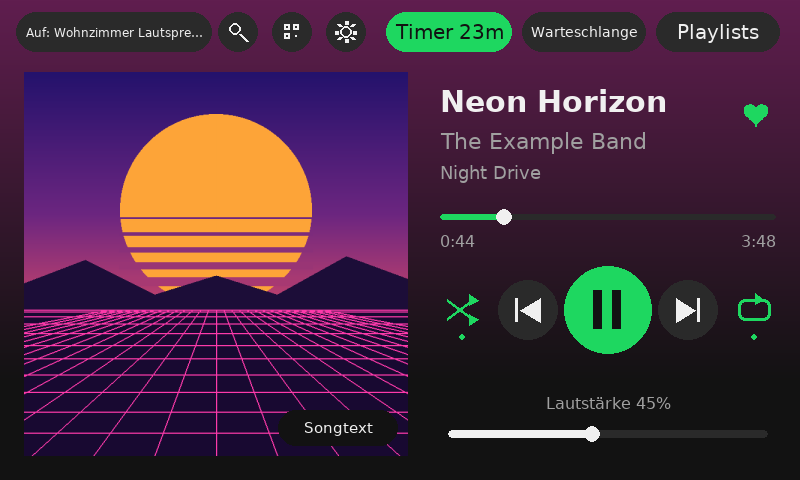
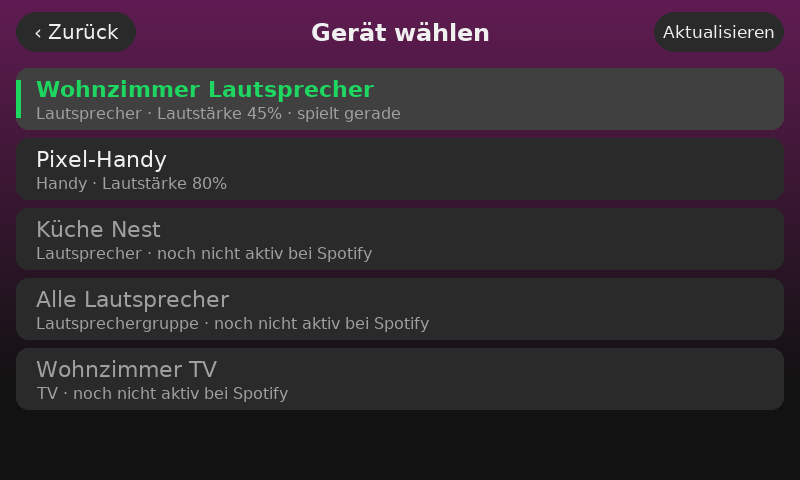
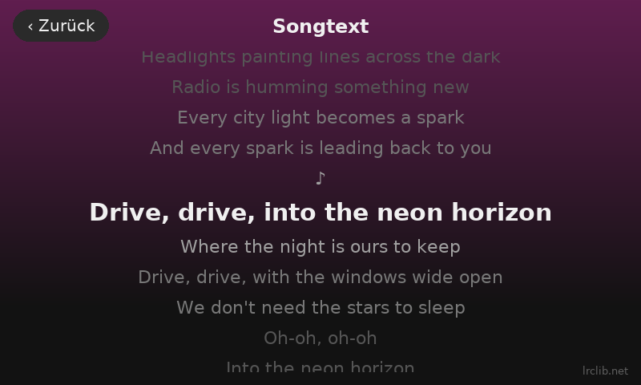
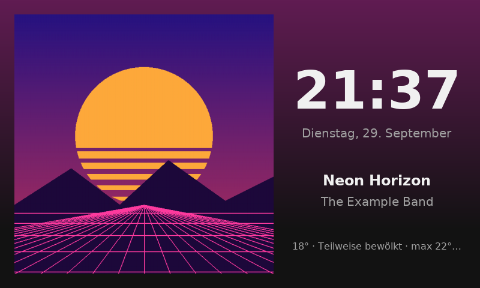
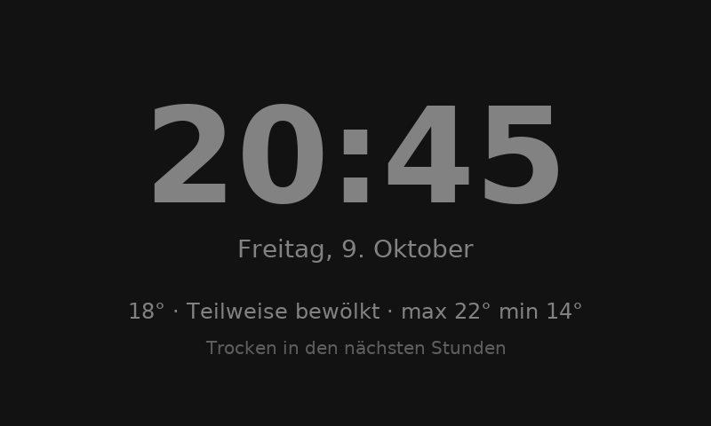
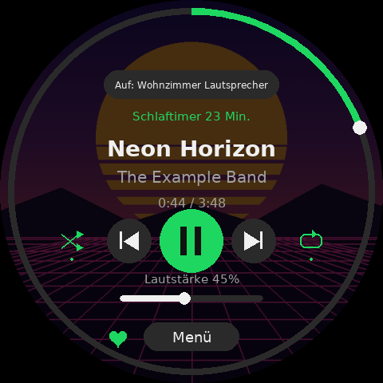
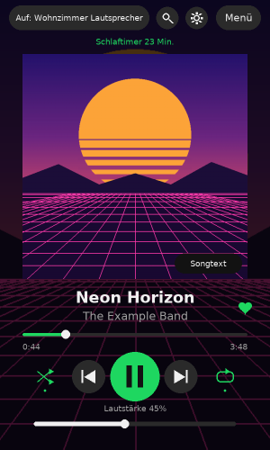

# SpotiScherm

🇬🇧 [English](README.md) · 🇳🇱 [Nederlands](README.nl.md) · 🇩🇪 **Deutsch**

Ein Touchscreen für dein Zimmer oder die Wand, mit dem du Spotify steuerst und die Musik an jedes
Spotify-Connect-Gerät im Haus schickst: Sonos, smarte Lautsprecher, Fernseher, PC oder Handy.
Läuft auf einem Raspberry Pi, vom allerersten Pi 1 bis zum Pi 5.

*„Scherm" ist Niederländisch für „Bildschirm". Die App spricht Deutsch, Englisch, Niederländisch, Französisch und Spanisch.*



| Gerät wählen | Mitlaufender Songtext |
|---|---|
|  |  |
| **Ruhebildschirm mit Albumcover** | **Uhr mit Wetter** |
|  |  |

| Runder Bildschirm (1080×1080) | Hochkant montiert |
|---|---|
|  |  |

## Funktionen

- **Wiedergabe:** Play/Pause, vorheriger/nächster Titel, Zufallswiedergabe und Wiederholen (aus →
  Playlist → Titel). Tippe oder ziehe auf der Fortschrittsleiste zum Spulen, die Lautstärke regelst
  du mit einem Schieberegler. „Zurück" springt zuerst an den Anfang des Titels, wie in der
  Spotify-App.
- **Geräte:** Tippe oben links auf den Gerätenamen, um die Wiedergabe auf einen anderen
  Lautsprecher, Fernseher, PC oder ein Handy zu verschieben. Auch Lautsprecher in deinem Netzwerk,
  die Spotify noch nicht kennt (zum Beispiel Google Cast), werden angezeigt (grau).
- **Playlists:** Scrolle durch deine Playlists und spiele eine ganze Liste ab oder starte bei einem
  Titel, danach läuft die Playlist einfach weiter. Mit **+ Warteschlange** landet ein Titel in der
  Warteschlange.
- **Zuletzt gespielt:** deine letzten Playlists, Alben und Titel, mit „vor 2 Std.".
- **Suche** mit Bildschirmtastatur: Titel, Künstler, Alben und Playlists.
- **Warteschlange:** sehen, was als Nächstes kommt.
- **Songtext:** Tippe auf das Albumcover. Die Texte kommen von [LRCLIB](https://lrclib.net) und
  laufen meistens mit dem Titel mit.
- **Teilen:** QR-Codes für den Song und die Playlist, die gerade laufen, und für dein Gast-WLAN.
  Gäste scannen sie mit der Handykamera. Tippe oben auf das QR-Symbol oder im Menü auf Teilen.
- **Schlaftimer:** Nach 15 bis 120 Minuten stoppt die Musik, in der letzten Minute wird sie leiser.
- **Ruhebildschirm:** Wird der Bildschirm eine Weile nicht berührt, erscheint das Albumcover groß
  mit der Uhrzeit. Läuft nichts, siehst du eine Uhr mit Wetter und Regenvorhersage.
- **Nachtmodus:** In der Stunde vor der Nacht wird der Bildschirm langsam dunkler. Nachts zeigt er
  eine stark gedimmte rote oder graue Uhr oder wird ganz schwarz.
- **Wischen:** Wische auf dem Hauptbildschirm nach links für den nächsten Titel und nach rechts
  für den vorherigen. Auf anderen Seiten wischst du nach rechts, um zurückzugehen.
- **Künstler- und Albumseite:** Tippe auf den Namen des Künstlers oder Albums auf dem Hauptbildschirm
  oder in den Suchergebnissen. Du siehst ihre Titel und Alben und spielst von dort ab.
- **Liken:** Tippe auf das Herz neben dem Titel, um den Song zu deinen Lieblingssongs hinzuzufügen
  oder wieder zu entfernen.
- **Lange Titel** laufen wie ein Lauftext durch.
- **Einstellungen am Bildschirm:** Wetter, Ruhebildschirm, Nachtmodus, Schriftart (7 zur Auswahl),
  Farbe (5 Farben oder die Farbe des Albumcovers), Sprache (Deutsch, Englisch, Niederländisch, Französisch, Spanisch),
  Bildschirm drehen (quer, hochkant, kopfüber), eine Info-Seite mit IP-Adresse, WLAN,
  Temperatur und Version, und Knöpfe, um den Pi sicher neu zu starten oder auszuschalten.
- **Updates:** Die App prüft auf GitHub, ob es eine neue Version gibt, und meldet das. Unter
  Einstellungen → Aktualisieren installierst du sie mit einem Tipp; Einstellungen und Anmeldung bleiben.
- **Musikwünsche von Gästen:** Gäste scannen einen QR-Code auf der Teilen-Seite, suchen auf dem
  Handy einen Song und fügen ihn zur Warteschlange hinzu (höchstens 3 pro Gast und Viertelstunde).
- **Einstellungen per Handy:** dieselben Einstellungen auf einer Webseite, unter
  `http://spotischerm.local:8080`. Unter Einstellungen → Per Handy zeigt der Bildschirm einen QR-Code.
- **Drei Bildschirmformen:** quer, rund (zum Beispiel Waveshare 1080×1080) und hochkant, jeweils mit
  eigenem Layout.

**So funktioniert es:** Der Pi spielt selbst keine Musik ab. Er ist eine Fernbedienung, die über die
Spotify Web API sagt: „Spiel das auf diesem Lautsprecher ab". Der Ton geht direkt von Spotify zu
diesem Lautsprecher. Die App zeichnet ohne Desktop direkt auf den Bildschirm und läuft deshalb auch
auf alten, langsamen Pis.

## Welcher Raspberry Pi?

✅ = tatsächlich getestet  ·  🟢 = sollte funktionieren, noch nicht getestet  ·  🟡 = funktioniert, aber langsam oder mit zusätzlichen Einstellungen

| Gerät | Prozessor | WLAN | Status | Zusätzliche Einstellungen | Geschwindigkeit |
|---|---|---|---|---|---|
| **Pi 1** (Model A, A+, B, B+) | 1 Kern, 700 MHz | nein (Kabel oder Stick) | ✅🟡 getestet auf einem **Model B** | `SPOTISCHERM_FRAMEBUFFER=1`, `SPOTISCHERM_ZUINIG=1` und eine niedrige Auflösung | ~4 fps bei 1440×900, ~10 fps bei 800×600 |
| **Pi Zero / Zero W** | 1 Kern, 1 GHz | Zero W: ja | 🟡 gleicher Chip wie der Pi 1, etwas schneller | vermutlich wie beim Pi 1 | etwas besser als der Pi 1 |
| **Pi 2B** | 4 Kerne, 900 MHz | nein (Kabel oder Stick) | 🟢 | `SPOTISCHERM_ZUINIG=1` empfohlen; `FRAMEBUFFER` nur, wenn der Bildschirm schwarz bleibt | ordentlich |
| **Pi Zero 2 W** | 4 Kerne, 1 GHz | ja | 🟢 | keine | gut, dazu klein und günstig |
| **Pi 3B / 3B+ / 3A+** | 4 Kerne, 1,2–1,4 GHz | ja | ✅ getestet auf einem 3B+, **Empfehlung** | keine | gut |
| **Pi 4** | 4 Kerne, 1,5–1,8 GHz | ja | 🟢 | keine | flüssig, auch rund mit 1080×1080 |
| **Pi 5** | 4 Kerne, 2,4 GHz | ja | 🟢 | keine | flüssig, auch rund mit 1080×1080 |
| **Windows-PC** (zum Testen) | – | – | ✅ getestet unter Windows 11 | `SPOTISCHERM_WINDOWED=1` oder `SPOTISCHERM_MUIS=1` | flüssig |

**Betriebssystem:** **Raspberry Pi OS Lite**, neueste Version („Lite" heißt ohne Desktop, den braucht
die App nicht). Für Pi 1, Zero, Zero W und 2B ist das die 32-Bit-Version. Bei den anderen gehen 32-
und 64-Bit; der Raspberry Pi Imager zeigt nur, was zu deinem Pi passt.

**Am meisten zählt** für die Geschwindigkeit die Anzahl der Pixel. Ein Pi 1 oder Zero ist mit einem
800×480-Bildschirm völlig ausreichend, tut sich mit einem großen Bildschirm aber schwer. Den runden
1080×1080-Bildschirm würde ich nur mit einem Pi 4 oder 5 betreiben.

Läuft es bei dir auf einem anderen Modell? Sag Bescheid, dann kommt es in die Tabelle.

## Was du brauchst

- Einen Raspberry Pi (siehe oben), ein Netzteil und eine microSD-Karte mit 16 oder 32 GB.
- Einen Touchscreen mit **HDMI für das Bild und USB für Touch**, zum Beispiel 5" oder 7" mit 800×480
  oder 1024×600 Pixeln. Die funktionieren ohne Treiber.
- WLAN. Hat dein Pi keins (Pi 1, Pi 2B), nimm ein Netzwerkkabel oder einen WLAN-Stick wie den
  TP-Link TL-WN725N.
- **Spotify Premium.** Ohne Premium lässt sich die Wiedergabe über die API nicht steuern.

**Kauf keinen kleinen 3,5"-Bildschirm, der auf die GPIO-Pins gesteckt wird (SPI).** Die brauchen
spezielle Treiber, sind langsam und gehen nach einem Systemupdate oft kaputt.

### Ein runder Bildschirm

Die App hat auch ein rundes Layout, zum Beispiel für das **Waveshare 5inch 1080×1080 round LCD**
(HDMI, Touch über USB-C). Der Fortschritt ist dann ein Ring am Rand: tippe oder ziehe darauf zum
Spulen. Geräte, Playlists und der Rest liegen unter **Menü**. Bei einem quadratischen Bildschirm
wählt die App das runde Layout selbst (`SCHERM_VORM=auto`).

**Auflösung einstellen.** Das aktuelle Raspberry Pi OS nutzt den KMS-Treiber, der die
`hdmi_timings`-Zeilen aus dem Waveshare-Wiki ignoriert. Bekommst du kein Bild in 1080×1080, schreibe
`video=HDMI-A-1:1080x1080@60` an den Anfang der (einzigen) Zeile in `/boot/firmware/cmdline.txt` und
starte neu. Klappt das nicht, probiere `video=HDMI-A-1:1080x1080R@60`. Das ist am echten runden
Bildschirm noch nicht getestet.

**Test am PC:** Setze `SCHERM_VORM=rond` und `SPOTISCHERM_WINDOWED=1`. Du bekommst ein Fenster mit
540×540 Pixeln und schwarzen Ecken, genau wie auf dem echten Bildschirm.

### Ein alter Pi (Pi 1, Zero, 2B)?

Das geht mit dem **Sparmodus**. In `config.env`:

```
SPOTISCHERM_ZUINIG=1
```

Die App nutzt dann ein kleineres Albumcover (300 statt 640 px), zeichnet höchstens 10 Bilder pro
Sekunde, kürzt lange Titel statt sie laufen zu lassen und lässt den farbigen Hintergrund weg. Mit
`SPOTISCHERM_TOON_FPS=1` siehst du oben rechts, wie schnell sie läuft.

**Bleibt der Bildschirm auf einem Pi 1 schwarz?** So war es in unserem Test: Die normale Art zu
zeichnen (SDL über die Grafikeinheit) lieferte dort kein Bild. Schalte dann auch das ein:

```
SPOTISCHERM_FRAMEBUFFER=1
```

Die App schreibt dann direkt in den Framebuffer und liest Touch und Maus selbst aus. Bei einem großen
Bildschirm hilft auch eine niedrigere Auflösung, etwa `video=HDMI-A-1:1440x900@60` am Anfang von
`/boot/firmware/cmdline.txt`. Die ganze Geschichte steht in
[TROUBLESHOOTING.md](TROUBLESHOOTING.md#the-screen-stays-black) (Englisch).

## Installation

### 1. Eine Spotify-App anlegen (5 Minuten, am PC)

1. Gehe zu <https://developer.spotify.com/dashboard> und melde dich an.
2. Klicke auf **Create app**. Name: `SpotiScherm`. Beschreibung: beliebig.
3. Trage unter **Redirect URIs** genau das ein: `http://127.0.0.1:8888/callback`
4. Hake **Web API** an, akzeptiere die Bedingungen und speichere.
5. Öffne **Settings** und notiere dir **Client ID** und **Client Secret**.

### 2. Die SD-Karte vorbereiten (am PC)

1. Installiere den **Raspberry Pi Imager**: <https://www.raspberrypi.com/software/>
2. Wähle dein Pi-Modell, **Raspberry Pi OS (other) → Raspberry Pi OS Lite** und deine SD-Karte.
3. Unter **OS-Anpassung**:
   - Hostname: `spotischerm`
   - Benutzername und Passwort nach Wahl
   - WLAN: Netzwerkname, Passwort und Land
   - Reiter Dienste: **SSH aktivieren**
4. Karte beschreiben, in den Pi stecken, Bildschirm anschließen (HDMI + USB-Touch) und Strom an.

### 3. SpotiScherm installieren (auf dem Pi)

```bash
ssh DEINNAME@spotischerm.local
```

```bash
sudo apt install -y git && git clone https://github.com/GamenHaaDee/Spotischerm.git ~/spotify-scherm
```

```bash
cd ~/spotify-scherm && bash install.sh
```

Führe `install.sh` als dein normaler Benutzer aus, **nicht** mit `sudo`. Trage danach Client ID und
Secret ein (speichern mit Strg+O, Enter, Strg+X):

```bash
nano config.env
```

### 4. Einmal bei Spotify anmelden

```bash
.venv/bin/python app/auth.py
```

Du bekommst einen langen Link. Öffne ihn **am PC**, melde dich an und klicke auf Zustimmen. Dein
Browser geht dann zu `http://127.0.0.1:8888/callback?code=...` und meldet, dass es die Seite nicht
gibt. **Das ist richtig so.** Kopiere die ganze Adresszeile, füge sie ins SSH-Fenster ein und drücke
Enter.

### 5. Neu starten

```bash
sudo reboot
```

Nach etwa 30 Sekunden erscheint SpotiScherm auf dem Bildschirm und startet ab dann automatisch. Auf
einem Pi 1 dauert das etwa eine Minute.

## Einstellungen

Die meisten Einstellungen wählst du direkt am Bildschirm über das Zahnrad. Standardwerte und
Hardware-Einstellungen stehen in `config.env`. Was du am Bildschirm wählst, wird in
`instellingen.json` gespeichert und hat Vorrang vor `config.env`. **Alle Einstellungen mit
Standardwert und Erklärung findest du in [CONFIGURATION.md](CONFIGURATION.md)** (Englisch).

## Aktualisieren

Deine Einstellungen, deine Anmeldung und deine `config.env` bleiben erhalten.

```bash
cd ~/spotify-scherm && git pull
```

```bash
bash install.sh
```

```bash
sudo systemctl restart spotischerm
```

`install.sh` kannst du bedenkenlos erneut ausführen: Es ergänzt nur, was neu ist (Pakete,
Schriftarten), und überschreibt deine `config.env` nie. Braucht eine neue Funktion eine
zusätzliche Berechtigung von Spotify (wie *Zuletzt gespielt*), sagt die App das. Führe dann einmal
`.venv/bin/python app/auth.py` aus.

Hast du den Ordner kopiert statt git zu nutzen? Dann kopiere nur den Ordner `app` erneut vom PC und
starte die App neu:

```bash
scp -r spotify-scherm/app DEINNAME@spotischerm.local:~/spotify-scherm/
```

## Deinstallieren

1. Die App stoppen und den Dienst entfernen:

   ```bash
   sudo systemctl disable --now spotischerm
   ```

   ```bash
   sudo rm /etc/systemd/system/spotischerm.service && sudo systemctl daemon-reload
   ```

2. Die App entfernen, samt Einstellungen und Spotify-Anmeldung:

   ```bash
   rm -rf ~/spotify-scherm
   ```

3. Entferne `/etc/sudoers.d/spotischerm` (`sudo rm /etc/sudoers.d/spotischerm`) und ein
   `video=...` am Anfang von `/boot/firmware/cmdline.txt`, falls du es selbst hinzugefügt hast.
4. Entziehe Spotify den Zugriff: Entferne deine App unter
   [Apps verwalten](https://www.spotify.com/account/apps/) in deinem Spotify-Konto. Die App selbst
   kannst du auch im [Developer-Dashboard](https://developer.spotify.com/dashboard) löschen.

Die Pakete, die `install.sh` installiert hat (pygame, Schriftarten, Mesa), können bleiben. Sie
schaden nicht, und andere Programme nutzen sie vielleicht auch.

## Erst am PC ausprobieren

Setze `SPOTISCHERM_WINDOWED=1` in `config.env`, führe `pip install pygame-ce spotipy zeroconf` aus,
dann `python app/auth.py` und `python app/spotischerm.py`. Du bekommst ein Fenster mit 800×480
Pixeln; Esc schließt es.

## Datenschutz: welche Daten wohin gehen

SpotiScherm hat keinen eigenen Server und sammelt nichts. Die App spricht nur mit diesen Diensten:

| Dienst | Was | Wann |
|---|---|---|
| **Spotify** (api.spotify.com, accounts.spotify.com) | Deine Anmeldung, was gerade läuft, deine Geräte, Playlists und „Zuletzt gespielt", Suchanfragen und deine Befehle (Play, Lautstärke …) | immer, dafür ist die App da |
| **Spotify-Bilder** (i.scdn.co) | Herunterladen des Albumcovers | bei jedem neuen Titel |
| **Open-Meteo** (open-meteo.com) | Der Ortsname, den du einträgst, danach dessen Koordinaten für die Vorhersage | nur wenn du einen Wetterort einträgst, alle 15 Minuten |
| **LRCLIB** (lrclib.net) | Titel, Künstler, Album und Länge des laufenden Titels | nur wenn du den Songtext öffnest |
| **Dein eigenes Netzwerk** | Suche nach Lautsprechern per mDNS, und Spotify-Connect-Geräte nach ihrem Namen fragen | solange die App läuft; das bleibt in deinem Netzwerk |
| **GitHub** (api.github.com) | Abfragen, welche Version die neueste ist, und sie herunterladen, wenn du auf Aktualisieren tippst | alle 6 Stunden; ausschalten mit `SPOTISCHERM_UPDATES=0` |
| **Dein eigenes Netzwerk** | Die Wunschseite (`/verzoekjes`): Jeder in deinem WLAN kann suchen und Songs zur Warteschlange hinzufügen | solange die App läuft; ausschalten mit `SPOTISCHERM_VERZOEKJES=0` |
| **Dein eigenes Netzwerk** | Die Einstellungsseite auf Port 8080. Jeder in deinem WLAN kann sie öffnen; sie zeigt und ändert nur die Bildschirmeinstellungen, nie deine Spotify-Schlüssel oder Passwörter | solange die App läuft; ausschalten mit `SPOTISCHERM_WEB_POORT=0` |

Alles Persönliche bleibt auf dem Pi: deine Spotify-Schlüssel (`config.env`), deine Anmeldung
(`.spotify-cache`) und deine Einstellungen (`instellingen.json`). Die `.gitignore` hält sie aus Git
heraus. Die Info-Seite liest IP-Adresse, WLAN und Temperatur nur auf dem Pi selbst aus.

## Bekannte Einschränkungen

- **Spotify Premium ist Pflicht.** Ohne Premium lässt die API keine Steuerung der Wiedergabe zu.
- **Höchstens 5 Konten pro Spotify-App.** Seit Februar 2026 gilt das für selbst erstellte Apps im
  *Development Mode*, und der Besitzer der App braucht Premium. Am besten legt also jeder seine
  eigene Spotify-App an (Schritt 1 oben).
- **Google-Cast-Lautsprecher sind grau**, bis du sie einmal in der Spotify-App auf dem Handy
  auswählst. Die Spotify Web API kennt sie nur, solange Spotify auf ihnen läuft, und daran kann die
  App nichts ändern. Siehe
  [TROUBLESHOOTING.md](TROUBLESHOOTING.md#speakers-are-grey-in-the-device-list).
- **Kein Jam** und **kein Multiroom**: Die Spotify-API bietet dafür keine Funktionen. Eine
  Lautsprechergruppe (etwa „Alle Lautsprecher" von Google) funktioniert aber.
- **Playlists von anderen:** Spotify liefert deren Titellisten nicht. Du kannst sie aber als Ganzes
  abspielen.
- **Die Suche** liefert höchstens 10 Ergebnisse pro Art, eine Grenze von Spotify.
- **Songtexte** gibt es nur, wenn LRCLIB sie hat, und das Timing ist ungefähr.
- **Das Dimmen** passiert in der Software. Die Hintergrundbeleuchtung bleibt an, nachts siehst du
  also noch ein schwaches Leuchten.
- **Alte Pis** (Pi 1, Zero) sind langsam, besonders mit einem großen Bildschirm. Im Framebuffer-Modus
  funktioniert eine Maus, es wird aber kein Mauszeiger gezeichnet.
- **Noch nicht auf echter Hardware getestet:** der runde Bildschirm, die Hochkant-Montage und die
  Pis 2B, 4 und 5. Tatsächlich getestet sind der Pi 1 Model B, der Pi 3B+ und Windows.

## Wenn etwas nicht funktioniert

Siehe **[TROUBLESHOOTING.md](TROUBLESHOOTING.md)** (Englisch): nach Symptom geordnet, mit Befehlen
zum Finden der Ursache und der Lösung. Die häufigsten:

| Problem | Lösung |
|---|---|
| Was macht die App? | `journalctl -u spotischerm -f` zeigt das Protokoll live |
| Die App läuft, aber der Bildschirm bleibt schwarz | `SPOTISCHERM_FRAMEBUFFER=1` in `config.env`, und bei einem großen Bildschirm eine niedrigere Auflösung |
| `pygame.error: EGL not initialized` | `sudo apt install libegl1 libegl-mesa0 libgles2 libgbm1 libgl1-mesa-dri` und `sudo reboot` |
| Tippen bewirkt nichts | Steckt das USB-Touch-Kabel im Pi? `sudo apt install evtest && sudo evtest` zeigt, ob der Pi den Touchscreen sieht |
| „Nicht erlaubt" | Spotify Premium wird benötigt, oder das Gerät lässt sich nicht fernsteuern |
| `install.sh`: `$'\r': command not found` | Windows-Zeilenenden: `sed -i 's/\r$//' install.sh` |
| Nach Monaten abgemeldet | `app/auth.py` erneut ausführen |

## Eine Sprache hinzufügen

Alle Texte stehen in [app/i18n.py](app/i18n.py). Der niederländische Text ist der Schlüssel. Für
eine neue Sprache kopierst du den Block `"en"`, übersetzt die Texte rechts und trägst den Namen in
`LANGUAGES` ein. Was du nicht übersetzt, bleibt Niederländisch.

## Einen zusätzlichen Lautsprecher bauen

Du willst einen alten Pi als zusätzlichen Lautsprecher, der immer in der Geräteliste steht?
Installiere darauf [raspotify](https://dtcooper.github.io/raspotify/), mit einer USB-Soundkarte oder
einem DAC-HAT. Raspotify läuft auf dem Pi 2B und neuer, auf Pi 1 und Zero (ARMv6) aber nicht mehr.

## Lizenz

[MIT](LICENSE): Du darfst den Code frei nutzen, ändern und weitergeben, solange die Lizenz dabei
bleibt. Songtexte kommen von LRCLIB, das Wetter von Open-Meteo und die Musikdaten von Spotify,
jeweils zu deren eigenen Bedingungen. Spotify ist eine Marke der Spotify AB; dieses Projekt steht in
keiner Verbindung zu Spotify.
