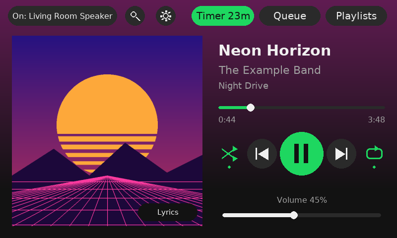
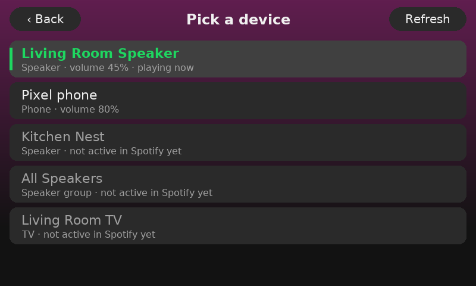
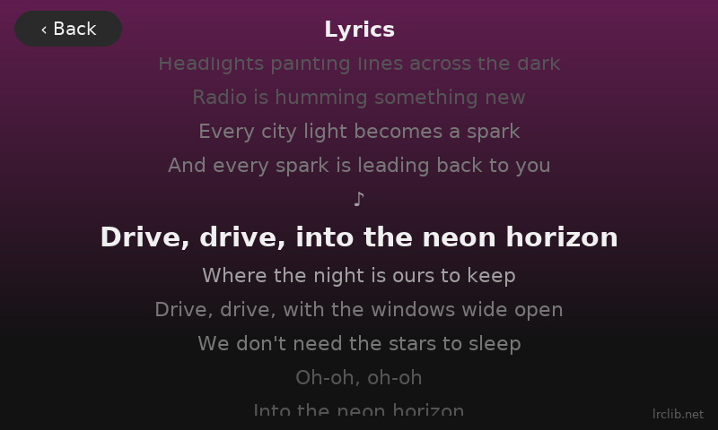
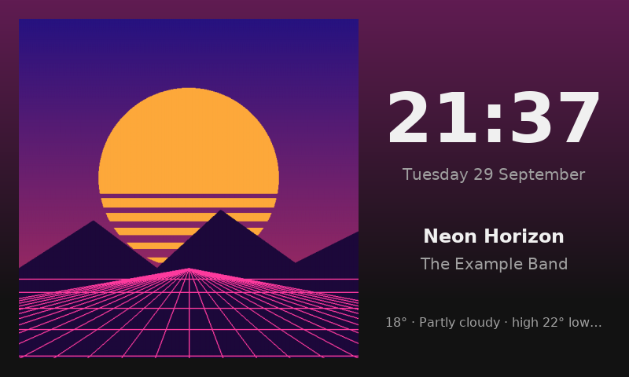
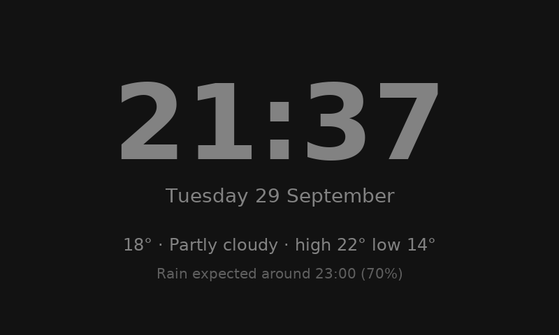
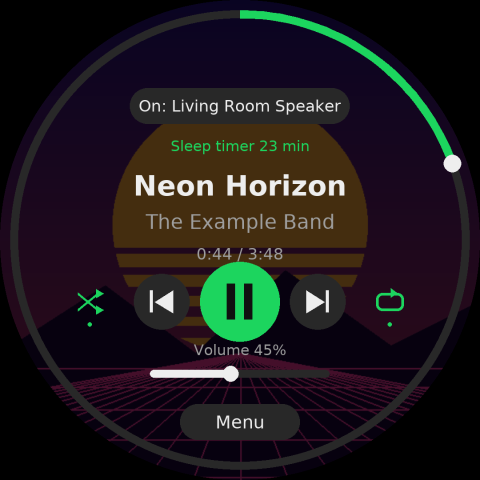
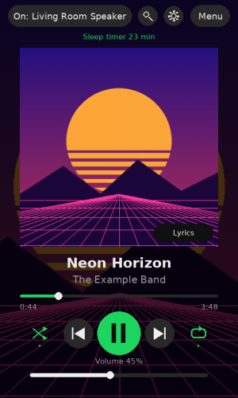

# SpotiScherm

🇬🇧 **English** · 🇳🇱 [Nederlands](README.nl.md) · 🇩🇪 [Deutsch](README.de.md)

A touchscreen for your room or your wall that controls Spotify and sends the music to any
Spotify Connect device in your home: Sonos, smart speakers, TV, PC or phone. It runs on a
Raspberry Pi, from the very first Pi 1 up to the Pi 5.

*"Scherm" is Dutch for "screen". The app speaks English, Dutch, German, French and Spanish.*



| Pick a device | Synced lyrics |
|---|---|
|  |  |
| **Idle screen with the album cover** | **Clock with weather** |
|  |  |

| Round display (1080×1080) | Mounted in portrait |
|---|---|
|  |  |

## Features

- **Playback:** play/pause, previous/next, shuffle and repeat (off → playlist → track). Tap or
  drag the progress bar to seek, and set the volume with a slider. Previous first jumps back to
  the start of the song, like the Spotify app does.
- **Devices:** tap the device name in the top left to move playback to another speaker, TV, PC or
  phone. Speakers on your network that Spotify doesn't know yet, such as Google Cast, are listed
  too (in grey).
- **Playlists:** scroll through your playlists and play a whole list, or start from one song and
  let the playlist continue. **+ Queue** adds a song to the queue instead.
- **Recently played:** your latest playlists, albums and songs, with "2 h ago".
- **Search** with an on-screen keyboard: songs, artists, albums and playlists.
- **Queue:** see what's up next.
- **Lyrics:** tap the album cover. Lyrics come from [LRCLIB](https://lrclib.net) and are usually
  synced to the song.
- **Share:** QR codes for the song and playlist that are playing, and for your guest Wi-Fi.
  Guests scan them with their phone camera. Tap the QR icon at the top, or Share in the menu.
- **Sleep timer:** the music stops after 15 to 120 minutes, and fades out during the last minute.
- **Idle screen:** when nobody touches the screen for a while, the album cover is shown large with
  the time. When nothing is playing, you get a clock with the weather and a rain forecast.
- **Night mode:** the screen slowly dims in the hour before night. At night it shows a very dim red
  or grey clock, or goes completely black.
- **Swipe:** on the main screen, swipe left for the next song and right for the previous one. On
  other screens, swipe right to go back.
- **Artist and album pages:** tap the artist or album name on the main screen, or an artist or
  album in the search results. You see their songs and albums, and play from there.
- **Like:** tap the heart next to the title to add the song to your Liked Songs, or remove it.
- **Long titles** scroll like a news ticker.
- **Settings on the screen:** weather, idle screen, night mode, font (7 choices), colour (5 colours,
  or the colour of the album cover), language (English, Dutch, German, French, Spanish), screen rotation
  (landscape, portrait, upside down), an info page with IP address, Wi-Fi, temperature and
  version, and buttons to restart or shut down the Pi safely.
- **Updates:** the app checks GitHub for new versions and tells you when one is out. Under
  Settings → Update you install it with one tap; your settings and login stay as they are.
- **Requests from guests:** guests scan a QR code on the Share page, search for a song on their
  phone and add it to the queue (at most 3 per guest per 15 minutes).
- **Settings from your phone:** the same settings on a web page, at `http://spotischerm.local:8080`.
  Under Settings → From your phone the screen shows a QR code with the address.
- **Three screen shapes:** landscape, round (for example Waveshare 1080×1080) and portrait, each
  with its own layout.

**How it works:** the Pi doesn't play any music itself. It's a remote control that tells Spotify,
through the Spotify Web API, "play this on that speaker". The audio goes straight from Spotify to
that speaker. The app draws directly on the screen without a desktop, so it also runs on old,
slow Pis.

## Which Raspberry Pi?

✅ = actually tested  ·  🟢 = expected to work, not tested yet  ·  🟡 = works, but slow or with extra settings

| Device | CPU | Wi-Fi | Status | Extra settings | Speed |
|---|---|---|---|---|---|
| **Pi 1** (Model A, A+, B, B+) | 1 core, 700 MHz | no (cable or dongle) | ✅🟡 tested on a **Model B** | `SPOTISCHERM_FRAMEBUFFER=1`, `SPOTISCHERM_ZUINIG=1`, and a low resolution | ~4 fps at 1440×900, ~10 fps at 800×600 |
| **Pi Zero / Zero W** | 1 core, 1 GHz | Zero W: yes | 🟡 same chip as the Pi 1, a bit faster | probably the same as the Pi 1 | a bit better than the Pi 1 |
| **Pi 2B** | 4 cores, 900 MHz | no (cable or dongle) | 🟢 | `SPOTISCHERM_ZUINIG=1` recommended; `FRAMEBUFFER` only if the screen stays black | fair |
| **Pi Zero 2 W** | 4 cores, 1 GHz | yes | 🟢 | none | good, and small and cheap |
| **Pi 3B / 3B+ / 3A+** | 4 cores, 1.2–1.4 GHz | yes | ✅ tested on a 3B+, **recommended** | none | good |
| **Pi 4** | 4 cores, 1.5–1.8 GHz | yes | 🟢 | none | smooth, also on a 1080×1080 round screen |
| **Pi 5** | 4 cores, 2.4 GHz | yes | 🟢 | none | smooth, also on a 1080×1080 round screen |
| **Windows PC** (for testing) | n/a | n/a | ✅ tested on Windows 11 | `SPOTISCHERM_WINDOWED=1` or `SPOTISCHERM_MUIS=1` | smooth |

**Operating system:** **Raspberry Pi OS Lite**, latest version ("Lite" means no desktop, which the
app doesn't need). On the Pi 1, Zero, Zero W and 2B that's the 32-bit version. On the others,
32-bit or 64-bit both work; Raspberry Pi Imager only offers what fits your Pi.

**What matters most** for speed is the number of pixels. A Pi 1 or Zero is fine with an 800×480
screen, but struggles with a big one. I'd only use the 1080×1080 round screen with a Pi 4 or 5.

Got it running on another model? Let me know, and I'll add it to this table.

## What you need

- A Raspberry Pi (see above), a power supply and a 16 or 32 GB microSD card.
- A touchscreen with **HDMI for the picture and USB for touch**, such as a 5" or 7" screen with
  800×480 or 1024×600 pixels. Those work without drivers.
- Wi-Fi. If your Pi doesn't have it (Pi 1, Pi 2B), use a network cable or a Wi-Fi dongle such as
  the TP-Link TL-WN725N.
- **Spotify Premium.** Without Premium, the API doesn't let you control playback.

**Don't buy a small 3.5" screen that plugs onto the GPIO pins (SPI).** They need special drivers,
are slow, and often break after an OS update.

### A round screen

The app has a round layout too, for example for the **Waveshare 5inch 1080×1080 round LCD** (HDMI,
touch over USB-C). Progress is then shown as a ring around the edge: tap or drag it to seek.
Devices, playlists and the rest are under **Menu**. On a square screen the app picks the round
layout by itself (`SCHERM_VORM=auto`).

**Setting the resolution.** Current Raspberry Pi OS uses the KMS driver, which ignores the
`hdmi_timings` lines from the Waveshare wiki. If you don't get a 1080×1080 picture, add
`video=HDMI-A-1:1080x1080@60` at the start of the (single) line in `/boot/firmware/cmdline.txt` and
reboot. If that doesn't work, try `video=HDMI-A-1:1080x1080R@60`. This hasn't been tested on the
real round screen yet.

**Testing on a PC:** set `SCHERM_VORM=rond` and `SPOTISCHERM_WINDOWED=1`. You get a 540×540 window
with black corners, just like the real screen.

### An old Pi (Pi 1, Zero, 2B)?

That works with **economy mode**. In `config.env`:

```
SPOTISCHERM_ZUINIG=1
```

The app then uses a smaller album cover (300 instead of 640 px), draws at most 10 frames per
second, cuts long titles off instead of scrolling them, and skips the coloured background. With
`SPOTISCHERM_TOON_FPS=1` the frame rate is shown in the top right.

**Screen stays black on a Pi 1?** That's what happened in our test: the normal way of drawing
(SDL through the GPU) didn't produce a picture there. Turn this on as well:

```
SPOTISCHERM_FRAMEBUFFER=1
```

The app then writes straight into the framebuffer, and reads touch and mouse input itself. On a
big screen, a lower resolution helps too, such as `video=HDMI-A-1:1440x900@60` at the start of
`/boot/firmware/cmdline.txt`. The full story is in
[TROUBLESHOOTING.md](TROUBLESHOOTING.md#the-screen-stays-black).

## Installation

### 1. Create a Spotify app (5 minutes, on your PC)

1. Go to <https://developer.spotify.com/dashboard> and log in.
2. Click **Create app**. Name: `SpotiScherm`. Description: anything you like.
3. Under **Redirect URIs**, enter exactly: `http://127.0.0.1:8888/callback`
4. Tick **Web API**, accept the terms, and save.
5. Open **Settings** and note the **Client ID** and **Client Secret**.

### 2. Prepare the SD card (on your PC)

1. Install **Raspberry Pi Imager**: <https://www.raspberrypi.com/software/>
2. Pick your Pi model, **Raspberry Pi OS (other) → Raspberry Pi OS Lite**, and your SD card.
3. Under **OS customisation**:
   - hostname: `spotischerm`
   - a username and password of your choice
   - Wi-Fi: your network name, password and country
   - Services tab: **enable SSH**
4. Write the card, put it in the Pi, connect the screen (HDMI + USB touch) and power it up.

### 3. Install SpotiScherm (on the Pi)

```bash
ssh YOURNAME@spotischerm.local
```

```bash
sudo apt install -y git && git clone https://github.com/GamenHaaDee/Spotischerm.git ~/spotify-scherm
```

```bash
cd ~/spotify-scherm && bash install.sh
```

Run `install.sh` as your normal user, **not** with `sudo`. Then fill in your Client ID and Secret
(save with Ctrl+O, Enter, Ctrl+X):

```bash
nano config.env
```

### 4. Log in to Spotify once

```bash
.venv/bin/python app/auth.py
```

You get a long link. Open it **on your PC**, log in and click Agree. Your browser then goes to
`http://127.0.0.1:8888/callback?code=...` and says the page doesn't exist. **That's expected.**
Copy the whole address bar, paste it into the SSH window and press Enter.

### 5. Reboot

```bash
sudo reboot
```

After about 30 seconds SpotiScherm appears on the screen, and from then on it starts
automatically. On a Pi 1 this takes about a minute.

## Settings

Most settings are chosen on the screen itself, through the gear icon. Defaults and hardware
settings live in `config.env`. What you choose on the screen is saved in `instellingen.json` and
takes priority over `config.env`. **Every setting, with its default and meaning, is listed in
[CONFIGURATION.md](CONFIGURATION.md).**

## Updating

Your settings, your login and your `config.env` stay as they are.

```bash
cd ~/spotify-scherm && git pull
```

```bash
bash install.sh
```

```bash
sudo systemctl restart spotischerm
```

`install.sh` is safe to run again: it only adds what's new (packages, fonts) and never overwrites
your `config.env`. If a new feature needs an extra Spotify permission (like *Recently played*
did), the app says so; then run `.venv/bin/python app/auth.py` once.

Installed by copying the folder instead of with git? Copy just the `app` folder from your PC
again, and restart the app:

```bash
scp -r spotify-scherm/app YOURNAME@spotischerm.local:~/spotify-scherm/
```

## Uninstalling

1. Stop the app and remove the service:

   ```bash
   sudo systemctl disable --now spotischerm
   ```

   ```bash
   sudo rm /etc/systemd/system/spotischerm.service && sudo systemctl daemon-reload
   ```

2. Remove the app, including your settings and your Spotify login:

   ```bash
   rm -rf ~/spotify-scherm
   ```

3. Remove `/etc/sudoers.d/spotischerm` (`sudo rm /etc/sudoers.d/spotischerm`), and undo a
   `video=...` part at the start of `/boot/firmware/cmdline.txt` if you added one.
4. Revoke the access at Spotify: under [Manage apps](https://www.spotify.com/account/apps/) on
   your Spotify account, remove your app. You can also delete the app itself in the
   [developer dashboard](https://developer.spotify.com/dashboard).

The packages `install.sh` installed (pygame, fonts, Mesa) can stay. They do no harm, and other
programs may use them too.

## Try it on a PC first

Set `SPOTISCHERM_WINDOWED=1` in `config.env`, run `pip install pygame-ce spotipy zeroconf`, then
`python app/auth.py` and `python app/spotischerm.py`. You get an 800×480 window; Esc closes it.

## Privacy: which data goes where

SpotiScherm has no server of its own and collects nothing. The app only talks to these services:

| Service | What | When |
|---|---|---|
| **Spotify** (api.spotify.com, accounts.spotify.com) | Your login, what's playing, your devices, playlists and recently played, searches, and the commands you give (play, volume…) | always, that's what the app is for |
| **Spotify images** (i.scdn.co) | Downloading the album cover | for every new song |
| **Open-Meteo** (open-meteo.com) | The place name you enter, then its coordinates for the forecast | only if you set a weather location, every 15 minutes |
| **LRCLIB** (lrclib.net) | Title, artist, album and length of the song that's playing | only when you open the lyrics |
| **Your own network** | Looking for speakers over mDNS, and asking Spotify Connect devices for their name | while the app runs; this stays on your network |
| **GitHub** (api.github.com) | Asking which version is the newest, and downloading it when you tap Update | every 6 hours; turn it off with `SPOTISCHERM_UPDATES=0` |
| **Your own network** | The requests page (`/verzoekjes`): anyone on your Wi-Fi can search and add songs to the queue | while the app runs; turn it off with `SPOTISCHERM_VERZOEKJES=0` |
| **Your own network** | The settings page on port 8080. Anyone on your Wi-Fi can open it; it shows and changes only the screen settings, never your Spotify keys or passwords | while the app runs; turn it off with `SPOTISCHERM_WEB_POORT=0` |

Everything personal stays on the Pi: your Spotify keys (`config.env`), your login
(`.spotify-cache`) and your settings (`instellingen.json`). The `.gitignore` keeps them out of git.
The info page reads the IP address, Wi-Fi and temperature on the Pi itself only.

## Known limitations

- **Spotify Premium is required.** Without it, the API doesn't allow controlling playback.
- **At most 5 accounts per Spotify app.** Since February 2026 this applies to self-made apps in
  *Development Mode*, and the owner of the app needs Premium. So it's best if everyone creates
  their own Spotify app (step 1 above).
- **Google Cast speakers are grey** until you pick them once in the Spotify app on your phone. The
  Spotify Web API only knows them while Spotify is running on them, and the app can't change that.
  See [TROUBLESHOOTING.md](TROUBLESHOOTING.md#speakers-are-grey-in-the-device-list).
- **No Jam** and **no multi-room**: the Spotify API offers no way to do either. A speaker group
  (such as a Google "All Speakers" group) does work.
- **Other people's playlists:** Spotify doesn't return their track lists. You can still play them
  as a whole.
- **Search** returns at most 10 results per type, a Spotify limit.
- **Lyrics** are only available if LRCLIB has them, and the timing is approximate.
- **Dimming** happens in software. The screen's backlight stays on, so at night you still see a
  faint glow.
- **Old Pis** (Pi 1, Zero) are slow, especially on a big screen. In framebuffer mode a mouse works,
  but no cursor is drawn.
- **Not yet tested on real hardware:** the round screen, portrait mounting, and the Pi 2B, 4
  and 5. The Pi 1 Model B, the Pi 3B+ and Windows have actually been tested.

## When something doesn't work

See **[TROUBLESHOOTING.md](TROUBLESHOOTING.md)**: symptom by symptom, with commands to find the
cause and the fix. The most common ones:

| Problem | Fix |
|---|---|
| What is the app doing? | `journalctl -u spotischerm -f` shows the log live |
| The app runs but the screen stays black | `SPOTISCHERM_FRAMEBUFFER=1` in `config.env`, and a lower resolution on a big screen |
| `pygame.error: EGL not initialized` | `sudo apt install libegl1 libegl-mesa0 libgles2 libgbm1 libgl1-mesa-dri` and `sudo reboot` |
| Taps do nothing | Is the USB touch cable plugged into the Pi? `sudo apt install evtest && sudo evtest` shows whether the Pi sees the touchscreen |
| "Not allowed" | Spotify Premium is needed, or that device can't be controlled remotely |
| `install.sh`: `$'\r': command not found` | Windows line endings: `sed -i 's/\r$//' install.sh` |
| Logged out after months | Run `app/auth.py` again |

## Adding a language

All texts live in [app/i18n.py](app/i18n.py). The Dutch text is the key. For a new language, copy
the `"en"` block, translate the texts on the right, and add the name to `LANGUAGES`. Anything you
don't translate stays in Dutch.

## Making an extra speaker

Want an old Pi as an extra speaker that's always in the device list? Install
[raspotify](https://dtcooper.github.io/raspotify/) on it, with a USB sound card or a DAC HAT.
Raspotify works on the Pi 2B and newer, but no longer on the Pi 1 and Zero (ARMv6).

## License

[MIT](LICENSE): you're free to use, change and share the code, as long as the license stays with it.
Lyrics come from LRCLIB, weather from Open-Meteo and music data from Spotify, each under their own
terms. Spotify is a trademark of Spotify AB; this project is not affiliated with Spotify.
