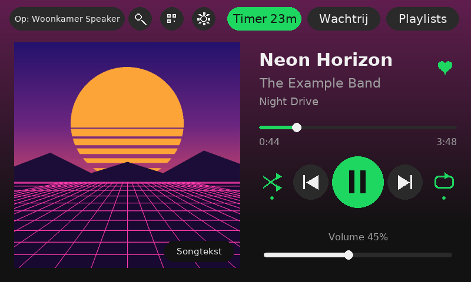
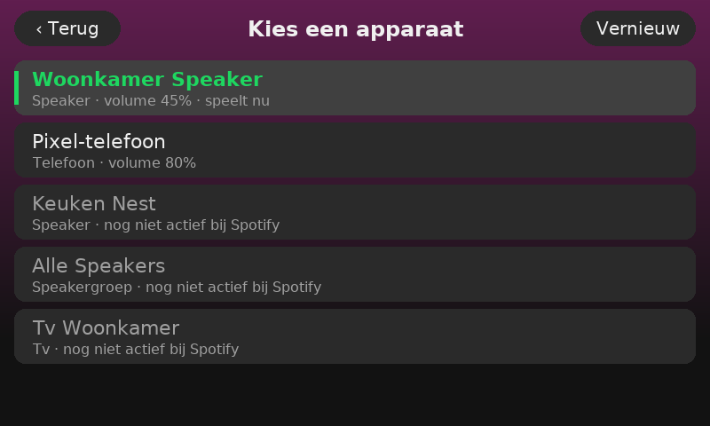
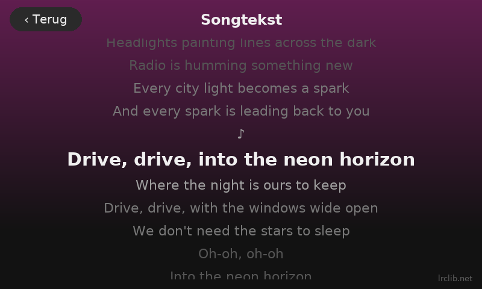
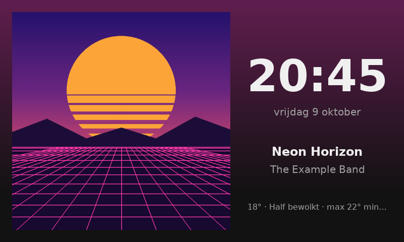
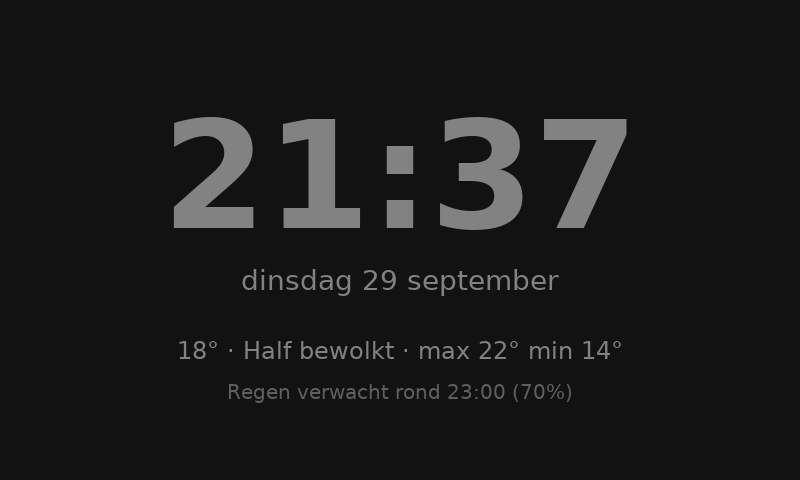
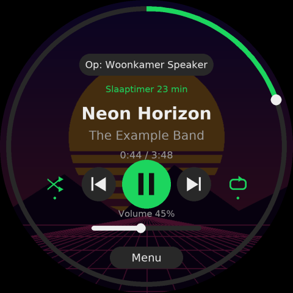
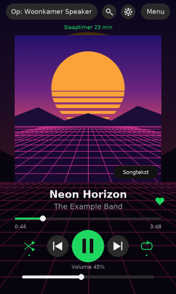

# SpotiScherm

🇬🇧 [English](README.md) · 🇳🇱 **Nederlands** · 🇩🇪 [Deutsch](README.de.md)

Een touchscreen voor op je kamer of aan de muur, waarmee je Spotify bedient en de muziek naar
elk Spotify Connect-apparaat in huis stuurt: Sonos, slimme speakers, tv, pc of telefoon. Draait
op een Raspberry Pi, van de allereerste Pi 1 tot de Pi 5.



| Apparaat kiezen | Meelopende songtekst |
|---|---|
|  |  |
| **Rustscherm met de hoes** | **Klok met weer** |
|  |  |

| Rond scherm (1080×1080) | Staand opgehangen |
|---|---|
|  |  |

## Wat het kan

- **Bediening:** play/pauze, vorige/volgende, shuffle en herhalen (uit → playlist → nummer).
  Tik of sleep op de voortgangsbalk om te spoelen, en regel het volume met een schuifbalk.
  Terug gaat eerst naar het begin van het nummer, zoals in de Spotify-app.
- **Apparaten:** tik linksboven op de naam van het apparaat om het afspelen naar een andere
  speaker, tv, pc of telefoon over te zetten. Ook speakers in je netwerk die Spotify nog niet
  kent, zoals Google Cast, staan in de lijst (grijs).
- **Playlists:** scroll door je playlists en start een hele lijst of één nummer, waarna de
  playlist gewoon verder speelt. Met **+ Wachtrij** zet je een nummer in de wachtrij.
- **Recent gespeeld:** je laatste playlists, albums en nummers, met "2 uur geleden".
- **Zoeken** met een schermtoetsenbord: nummers, artiesten, albums en playlists.
- **Wachtrij:** zien wat er hierna komt.
- **Songtekst:** tik op de hoes. Teksten komen van [LRCLIB](https://lrclib.net) en lopen meestal
  mee met het nummer.
- **Delen:** QR-codes van het nummer en de playlist die spelen, en van je gast-wifi. Gasten
  scannen ze met de camera van hun telefoon. Tik bovenin op het QR-icoon, of op Delen in het menu.
- **Slaaptimer:** na 15 tot 120 minuten stopt de muziek, en in de laatste minuut wordt hij
  langzaam zachter.
- **Rustscherm:** raak je het scherm een tijdje niet aan, dan verschijnt de albumhoes groot met
  de tijd erbij. Speelt er niks, dan zie je een klok met weer en regenverwachting.
- **Nachtmodus:** in het uur voor de nacht wordt het scherm langzaam donkerder. 's Nachts toont
  het een zeer gedimde rode of grijze klok, of wordt het helemaal zwart.
- **Lange titels** schuiven als een lichtkrant.
- **Instellingen op het scherm:** weer, rustscherm, nachtmodus, lettertype (7 keuzes), kleur
  (5 kleuren of de kleur van de hoes), taal (Nederlands, English, Deutsch), scherm draaien
  (liggend, staand, ondersteboven) en een info-pagina met IP-adres, wifi, temperatuur en versie.
- **Drie schermvormen:** liggend, rond (bijv. Waveshare 1080×1080) en staand, elk met een eigen
  indeling.

**Hoe het werkt:** de Pi speelt zelf geen muziek af. Hij is een afstandsbediening die via de
Spotify Web API zegt: "speel dit af op die speaker". Het geluid gaat rechtstreeks van Spotify
naar die speaker. De app tekent zonder desktop direct op het scherm, en werkt daardoor ook op
oude, trage Pi's.

## Op welke Pi werkt het?

✅ = echt getest  ·  🟢 = werkt naar verwachting, nog niet getest  ·  🟡 = werkt, maar traag of met extra instellingen

| Apparaat | Processor | Wifi | Status | Extra instellingen | Snelheid |
|---|---|---|---|---|---|
| **Pi 1** (Model A, A+, B, B+) | 1 kern, 700 MHz | nee (kabel of dongle) | ✅🟡 getest op een **Model B** | `SPOTISCHERM_FRAMEBUFFER=1`, `SPOTISCHERM_ZUINIG=1`, en een lage resolutie | ~4 fps op 1440×900, ~10 fps op 800×600 |
| **Pi Zero / Zero W** | 1 kern, 1 GHz | Zero W: ja | 🟡 zelfde chip als de Pi 1, iets sneller | waarschijnlijk dezelfde als de Pi 1 | iets beter dan de Pi 1 |
| **Pi 2B** | 4 kernen, 900 MHz | nee (kabel of dongle) | 🟢 | `SPOTISCHERM_ZUINIG=1` aanbevolen; `FRAMEBUFFER` alleen als het scherm zwart blijft | redelijk |
| **Pi Zero 2 W** | 4 kernen, 1 GHz | ja | 🟢 | geen | goed, en klein en goedkoop |
| **Pi 3B / 3B+ / 3A+** | 4 kernen, 1,2–1,4 GHz | ja | ✅ getest op een 3B+, **aanrader** | geen | goed |
| **Pi 4** | 4 kernen, 1,5–1,8 GHz | ja | 🟢 | geen | vloeiend, ook op 1080×1080 rond |
| **Pi 5** | 4 kernen, 2,4 GHz | ja | 🟢 | geen | vloeiend, ook op 1080×1080 rond |
| **Windows-pc** (om te testen) | n.v.t. | n.v.t. | ✅ getest op Windows 11 | `SPOTISCHERM_WINDOWED=1` of `SPOTISCHERM_MUIS=1` | vloeiend |

**Welk OS:** **Raspberry Pi OS Lite**, de nieuwste versie ("Lite" = zonder desktop, die heeft de
app niet nodig). Voor de Pi 1, Zero, Zero W en 2B is dat de 32-bit versie. Voor de andere mag
32-bit of 64-bit; de Raspberry Pi Imager laat alleen zien wat bij je Pi past.

**Wat het meeste uitmaakt** voor de snelheid is het aantal pixels. Een Pi 1 of Zero is prima met
een 800×480-scherm, maar heeft het zwaar met een groot scherm. Het ronde scherm van 1080×1080 zou
ik alleen aan een Pi 4 of 5 hangen.

Heb je het op een ander model draaiend gekregen? Laat het weten, dan komt het in deze tabel.

## Wat je nodig hebt

- Een Raspberry Pi (zie hierboven), een voeding en een microSD-kaart van 16 of 32 GB.
- Een touchscreen met **HDMI voor beeld en USB voor touch**, zoals een 5"- of 7"-scherm van
  800×480 of 1024×600. Dat werkt zonder drivers.
- Wifi. Heeft je Pi dat niet (Pi 1, Pi 2B), neem dan een netwerkkabel of een wifi-dongle zoals de
  TP-Link TL-WN725N.
- **Spotify Premium.** Zonder Premium kun je via de API niks bedienen.

**Koop geen klein 3,5"-scherm dat op de GPIO-pinnen zit (SPI).** Die hebben speciale drivers
nodig, zijn traag en gaan vaak stuk na een OS-update.

### Of: een rond scherm

De app heeft ook een ronde indeling, voor bijvoorbeeld het **Waveshare 5inch 1080×1080 round
LCD** (HDMI, touch via USB-C). De voortgang is dan een ring langs de rand: tik of sleep erop om te
spoelen. Apparaten, playlists en de rest zitten onder **Menu**. Bij een vierkant scherm kiest de app
de ronde indeling vanzelf (`SCHERM_VORM=auto`).

**Resolutie instellen.** Het huidige Raspberry Pi OS gebruikt de KMS-driver, en daar werken de
`hdmi_timings`-regels van Waveshare niet mee. Krijg je geen 1080×1080 beeld, zet dan vooraan in
`/boot/firmware/cmdline.txt` (op dezelfde regel) `video=HDMI-A-1:1080x1080@60` en herstart. Werkt
dat niet, probeer dan `video=HDMI-A-1:1080x1080R@60`. Dit is nog niet op het echte ronde scherm
getest.

**Testen op je pc:** zet `SCHERM_VORM=rond` en `SPOTISCHERM_WINDOWED=1`. Je krijgt dan een
venster van 540×540 met zwarte hoeken, zoals op het echte scherm.

### Op een oude Pi (Pi 1, Zero, 2B)?

Dat kan, met de **zuinige stand**. Zet in `config.env`:

```
SPOTISCHERM_ZUINIG=1
```

Dan gebruikt de app een kleinere hoes (300 in plaats van 640 px), tekent hij maximaal 10 beelden per
seconde, schuiven lange titels niet maar worden ze afgekapt, en valt de gekleurde achtergrond weg.
Met `SPOTISCHERM_TOON_FPS=1` zie je rechtsboven hoe snel hij is.

**Blijft het scherm zwart op een Pi 1?** Dat was bij onze test zo: de normale manier van tekenen
(SDL via de grafische chip) gaf daar geen beeld. Zet dan ook dit aan:

```
SPOTISCHERM_FRAMEBUFFER=1
```

De app tekent dan zelf rechtstreeks in het beeldgeheugen, en leest touch en muis zelf uit. Op een
groot scherm helpt ook een lagere resolutie, zoals `video=HDMI-A-1:1440x900@60` vooraan in
`/boot/firmware/cmdline.txt`. De volledige uitleg staat in
[TROUBLESHOOTING.md](TROUBLESHOOTING.md#the-screen-stays-black).

## Installatie

### 1. Spotify-app aanmaken (5 min, op je pc)

1. Ga naar <https://developer.spotify.com/dashboard> en log in.
2. Klik **Create app**. Naam: `SpotiScherm`. Beschrijving: wat je maar wilt.
3. Bij **Redirect URIs** vul je exact dit in: `http://127.0.0.1:8888/callback`
4. Vink **Web API** aan, accepteer de voorwaarden, sla op.
5. Open **Settings** en noteer de **Client ID** en de **Client Secret**.

### 2. SD-kaart klaarmaken (op je pc)

1. Installeer **Raspberry Pi Imager**: <https://www.raspberrypi.com/software/>
2. Kies je Pi-model, **Raspberry Pi OS (other) → Raspberry Pi OS Lite**, en je SD-kaart.
3. Bij **Aanpassen / OS customisation**:
   - hostnaam: `spotischerm`
   - gebruikersnaam + wachtwoord naar keuze
   - wifi: je netwerknaam en wachtwoord, en je land
   - tabblad Services: **SSH aanzetten**
4. Schrijven. Kaart in de Pi, scherm aansluiten (HDMI + USB-touch), stroom erop.

### 3. SpotiScherm installeren (op de Pi)

```bash
ssh JOUWNAAM@spotischerm.local
```

```bash
sudo apt install -y git && git clone https://github.com/GamenHaaDee/Spotischerm.git ~/spotify-scherm
```

```bash
cd ~/spotify-scherm && bash install.sh
```

Voer `install.sh` uit als je gewone gebruiker, **niet** met `sudo`. Vul daarna je Client ID en
Secret in (opslaan: Ctrl+O, Enter, Ctrl+X):

```bash
nano config.env
```

### 4. Eenmalig inloggen bij Spotify

```bash
.venv/bin/python app/auth.py
```

Je krijgt een lange link. Open die **op je pc**, log in en klik op Akkoord. Je browser gaat dan naar
`http://127.0.0.1:8888/callback?code=...` en zegt dat de pagina niet bestaat. **Dat hoort zo.**
Kopieer de hele adresbalk, plak hem in het SSH-venster en druk op Enter.

### 5. Herstarten

```bash
sudo reboot
```

Na ongeveer 30 seconden staat SpotiScherm op het scherm, en voortaan start het vanzelf op. Op een
Pi 1 duurt dat ongeveer een minuut.

## Instellingen

De meeste instellingen kies je op het scherm zelf, via het tandwiel. De standaardwaarden en de
instellingen voor de hardware staan in `config.env`, met uitleg bij elke regel (zie
[config.example.env](config.example.env)). Wat je op het scherm kiest, wordt bewaard in
`instellingen.json` en wint van `config.env`. **Alle instellingen, met hun standaardwaarde en
uitleg, staan op een rij in [CONFIGURATION.md](CONFIGURATION.md)** (Engels).

## Bijwerken

Je instellingen, je login en je `config.env` blijven gewoon staan.

```bash
cd ~/spotify-scherm && git pull
```

```bash
bash install.sh
```

```bash
sudo systemctl restart spotischerm
```

`install.sh` kun je gerust opnieuw draaien: hij voegt alleen toe wat nieuw is (pakketten,
lettertypes) en overschrijft je `config.env` nooit. Vraagt een nieuwe functie om een extra
toestemming van Spotify (zoals bij *Recent gespeeld*), dan zegt de app dat. Voer dan één keer
`.venv/bin/python app/auth.py` uit.

Heb je de map gekopieerd in plaats van git gebruikt? Kopieer dan alleen de map `app` opnieuw vanaf
je pc, en herstart de app:

```bash
scp -r spotify-scherm/app JOUWNAAM@spotischerm.local:~/spotify-scherm/
```

## Verwijderen

1. Stop de app en haal de service weg:

   ```bash
   sudo systemctl disable --now spotischerm
   ```

   ```bash
   sudo rm /etc/systemd/system/spotischerm.service && sudo systemctl daemon-reload
   ```

2. Verwijder de app, inclusief je instellingen en je Spotify-login:

   ```bash
   rm -rf ~/spotify-scherm
   ```

3. Draai de aanpassingen terug die je eventueel zelf hebt gedaan: een `video=...` vooraan in
   `/boot/firmware/cmdline.txt`, en `/etc/sudoers.d/spotischerm`.
4. Trek de toegang in bij Spotify: haal je app weg onder
   [Apps beheren](https://www.spotify.com/account/apps/) in je Spotify-account. De app zelf kun je
   ook verwijderen in het [developer-dashboard](https://developer.spotify.com/dashboard).

De pakketten die `install.sh` heeft geïnstalleerd (pygame, lettertypes, Mesa) mogen blijven
staan. Die kunnen geen kwaad, en andere programma's gebruiken ze misschien ook.

## Eerst op je pc testen?

Zet `SPOTISCHERM_WINDOWED=1` in `config.env`, installeer `pip install pygame-ce spotipy zeroconf`
en voer `python app/auth.py` en daarna `python app/spotischerm.py` uit. Je krijgt een venster van
800×480. Esc sluit het.

## Privacy: welke gegevens gaan waarheen

SpotiScherm heeft geen eigen server en verzamelt niks. De app praat alleen met deze diensten:

| Met wie | Wat | Wanneer |
|---|---|---|
| **Spotify** (api.spotify.com, accounts.spotify.com) | Je login, wat er speelt, je apparaten, playlists en recent gespeeld, zoekopdrachten, en de opdrachten die je geeft (play, volume…) | altijd, daar is de app voor |
| **Spotify-afbeeldingen** (i.scdn.co) | Het ophalen van de albumhoes | bij elk nieuw nummer |
| **Open-Meteo** (open-meteo.com) | De plaatsnaam die je instelt, en daarna de coördinaten ervan voor het weer | alleen als je een weerplaats instelt, elk kwartier |
| **LRCLIB** (lrclib.net) | Titel, artiest, album en lengte van het nummer dat speelt | alleen als je de songtekst opent |
| **Je eigen netwerk** | Zoeken naar speakers via mDNS, en Spotify Connect-apparaten naar hun naam vragen | zolang de app draait; dit blijft in je eigen netwerk |

Alles wat van jou is, blijft op de Pi: je Spotify-sleutels (`config.env`), je login
(`.spotify-cache`) en je instellingen (`instellingen.json`). De `.gitignore` zorgt dat die niet per
ongeluk op GitHub komen. De info-pagina leest IP-adres, wifi en temperatuur alleen op de Pi zelf uit.

## Bekende beperkingen

- **Spotify Premium is verplicht.** Zonder Premium kun je via de API niks bedienen.
- **Maximaal 5 accounts per Spotify-app.** Sinds februari 2026 geldt dat voor zelfgemaakte apps in
  *Development Mode*, en de eigenaar van de app moet Premium hebben. Iedereen maakt dus het beste
  een eigen Spotify-app aan (stap 1 hierboven).
- **Google Cast-speakers staan grijs** tot je ze één keer in de Spotify-app op je telefoon kiest. De
  Spotify Web API kent ze alleen terwijl Spotify erop draait, en daar kan de app niks aan doen. Zie
  [TROUBLESHOOTING.md](TROUBLESHOOTING.md#speakers-are-grey-in-the-device-list).
- **Geen Jam** en **geen multiroom**: Spotify biedt daar geen functies voor in de API. Een
  speakergroep (zoals "Alle Speakers" van Google) werkt wel.
- **Playlists van anderen:** daarvan geeft Spotify de nummers niet. Je kunt ze wel in zijn geheel
  afspelen.
- **Zoeken** geeft maximaal 10 resultaten per soort, dat is een grens van Spotify.
- **Songteksten** zijn er alleen als ze in LRCLIB staan, en de timing is een benadering.
- **Dimmen** gebeurt in de software. De achtergrondverlichting van het scherm blijft aan, dus 's
  nachts zie je nog een zwakke gloed.
- **Oude Pi's** (Pi 1, Zero) zijn traag, zeker op een groot scherm. In de framebuffer-stand zie je
  bij een muis geen cursor.
- **Nog niet op echte hardware getest:** het ronde scherm, het staand ophangen, en de Pi 2B, 4 en 5.
  De Pi 1 Model B, de Pi 3B+ en Windows zijn echt getest.

## Als iets niet werkt

Uitgebreide gids met diagnose-stappen per symptoom (in het Engels):
**[TROUBLESHOOTING.md](TROUBLESHOOTING.md)**. De meest voorkomende:

| Probleem | Oplossing |
|---|---|
| Wat doet de app? | `journalctl -u spotischerm -f` toont de logs live |
| App draait maar het scherm blijft zwart | `SPOTISCHERM_FRAMEBUFFER=1` in `config.env`, en op een groot scherm een lagere resolutie |
| `pygame.error: EGL not initialized` | `sudo apt install libegl1 libegl-mesa0 libgles2 libgbm1 libgl1-mesa-dri` en `sudo reboot` |
| Tikken werkt niet | Staat de USB-touchkabel in de Pi? `sudo apt install evtest && sudo evtest` laat zien of de Pi het touchscreen ziet |
| "Niet toegestaan" | Spotify Premium nodig, of dat apparaat laat zich niet op afstand bedienen |
| `install.sh`: `$'\r': command not found` | Windows-regeleindes: `sed -i 's/\r$//' install.sh` |
| Na maanden ineens uitgelogd | Voer `app/auth.py` opnieuw uit |

## Een taal toevoegen

Alle teksten staan in [app/i18n.py](app/i18n.py). De Nederlandse tekst is de sleutel. Voor een nieuwe
taal kopieer je het blok `"en"`, vertaal je de teksten rechts en zet je de naam in `LANGUAGES`.
Teksten die je niet vertaalt, blijven Nederlands.

## Een extra speaker maken

Wil je een oude Pi als extra speaker die altijd in de apparatenlijst staat? Installeer daar
[raspotify](https://dtcooper.github.io/raspotify/) op, met een USB-geluidskaartje of een DAC-HAT.
Raspotify werkt op de Pi 2B en nieuwer, en niet meer op de Pi 1 en Zero (ARMv6).

## Licentie

[MIT](LICENSE): je mag de code vrij gebruiken, aanpassen en delen, zolang de licentie erbij blijft.
Songteksten komen van LRCLIB, weer van Open-Meteo en muziekgegevens van Spotify, elk onder hun
eigen voorwaarden. Spotify is een merk van Spotify AB; dit project heeft daar geen banden mee.
